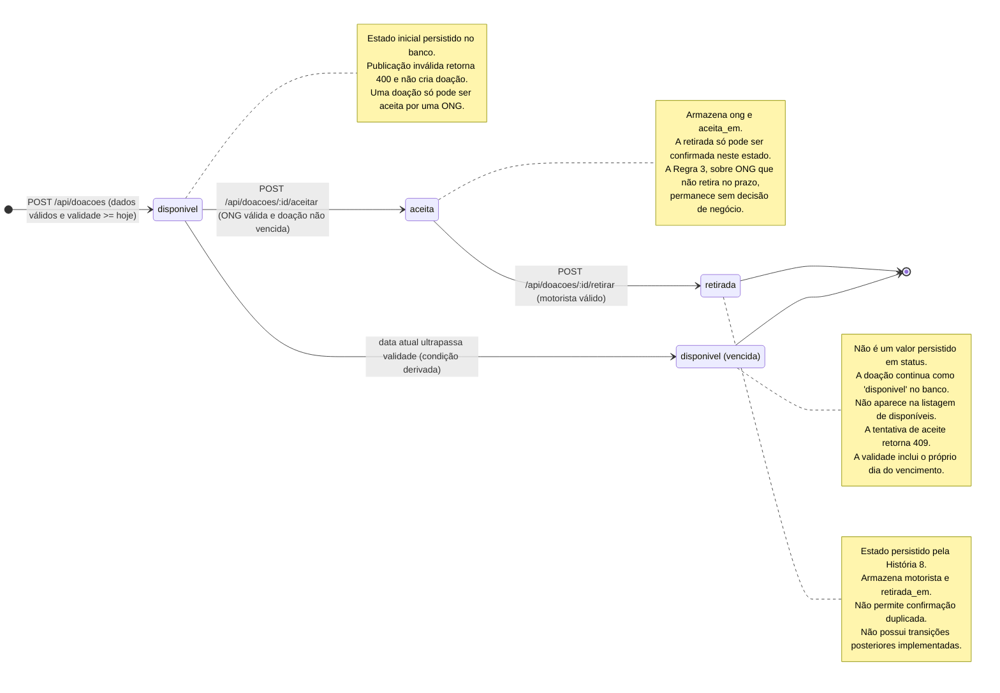

# Diagrama de Estados da doação (versão final)

Pergunta que responde: **quais estados uma doação pode assumir e quais eventos provocam as mudanças?**

Este diagrama contempla o fluxo original de publicação e aceite de doações e a evolução introduzida pela História 8, implementada na branch `feat/confirmar-retirada-doacao`, integrada à `main` pelo PR #10.

## Regras de transição

| Origem | Evento | Condição | Destino |
|---|---|---|---|
| Inicial | Publicar doação | Dados válidos e validade igual ou posterior à data atual | `disponivel` |
| `disponivel` | Aceitar doação | ONG válida, doação não vencida e ainda disponível | `aceita` |
| `disponivel` | Ultrapassar validade | Data atual posterior à validade | `disponivel (vencida)` — condição derivada |
| `aceita` | Confirmar retirada | Motorista válido e doação ainda aceita | `retirada` |

## Restrições e fluxos de erro

- **Publicação inválida:** retorna HTTP 400 e não cria o registro.
- **Aceite de doação inexistente:** retorna HTTP 404.
- **Aceite de doação vencida ou já aceita:** retorna HTTP 409.
- **Confirmação de retirada com motorista inválido:** retorna HTTP 400.
- **Confirmação de retirada de doação inexistente:** retorna HTTP 404.
- **Confirmação de retirada de doação ainda disponível:** retorna HTTP 409.
- **Confirmação duplicada de retirada:** retorna HTTP 409.
- **Confirmações simultâneas:** a atualização condicional no PostgreSQL permite que apenas uma confirmação seja efetivada.

## Persistência dos estados

Na implementação original, a tabela `doacoes` permite os estados `disponivel` e `aceita`.

A História 8 introduz a migração `002_adiciona_confirmacao_retirada.sql`, que acrescenta o estado `retirada` e os campos `motorista` e `retirada_em`.

O estado `disponivel (vencida)` não representa um novo valor gravado na coluna `status`. Trata-se de uma condição derivada da validade da doação.

**Situação de integração:** integrada à `main` pelo PR #10 (`fff59e0`). O estado `retirada` faz parte do comportamento atual.

## Fontes

- `migrations/001_cria_tabela_doacoes.sql`
- `migrations/002_adiciona_confirmacao_retirada.sql` — branch da História 8
- `src/repositorio.js` — `listarDisponiveis`, `marcarComoAceita`, `marcarComoRetirada`
- `src/doacoes.js` — `validarDadosDoacao`, `aceitar`, `confirmarRetirada`
- `src/app.js` — rotas de publicação, aceite e confirmação de retirada
- `docs/analise.md` — Regras 1, 2 e 3