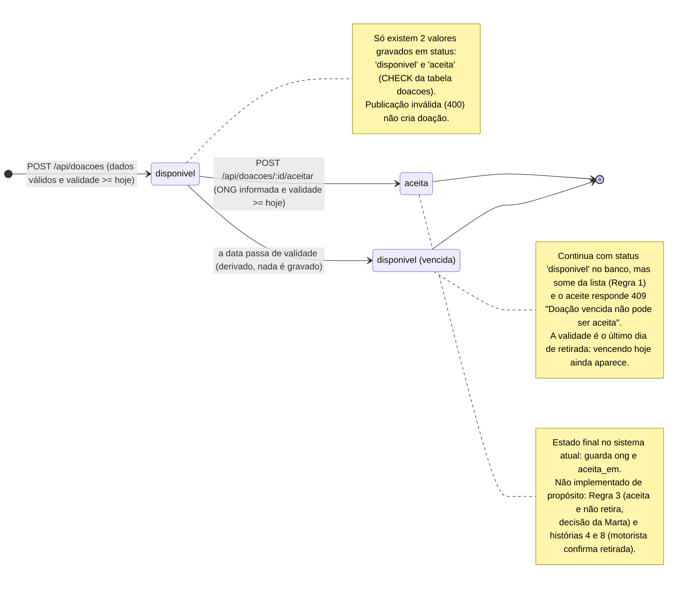

# Diagrama de Estados da doação (versão final)

Pergunta que responde: **quais estados uma doação pode assumir e quais eventos provocam as mudanças?**

Fontes: `migrations/001_cria_tabela_doacoes.sql` (CHECK de `status`), `src/repositorio.js`
(`listarDisponiveis`, `marcarComoAceita`), `src/doacoes.js` (`aceitar`, `validarDadosDoacao`),
`docs/analise.md` (Regras 1, 2 e 3).
