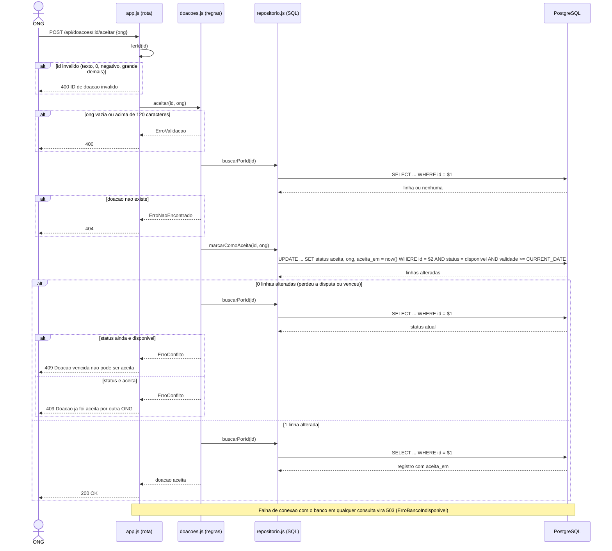

# Diagrama de Sequência — ONG aceita uma doação (versão final)

Pergunta que responde: **como as partes do sistema interagem durante o aceite e o que acontece em cada
caminho alternativo ou de erro?**

Fontes: `src/app.js` (`lerId`, rota 5, middleware de erros), `src/doacoes.js` (`aceitar`),
`src/repositorio.js` (`marcarComoAceita`), `src/erros.js`, `docs/analise.md` (risco de condição de corrida).
