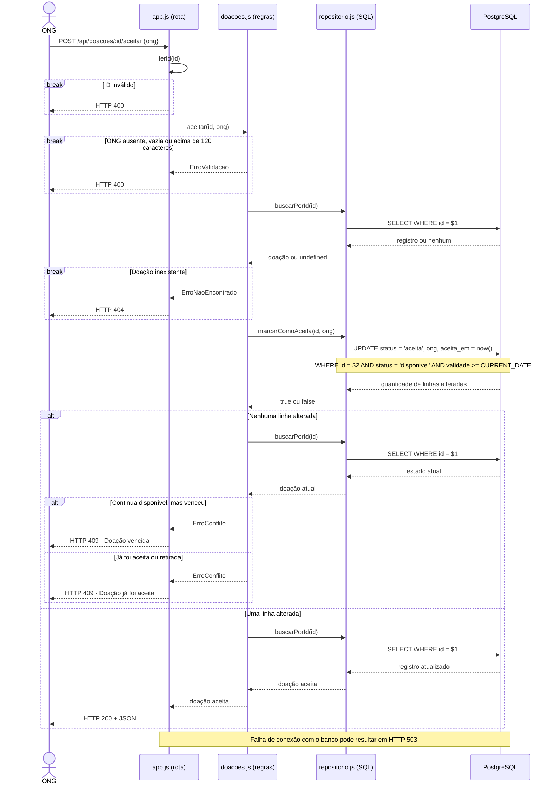
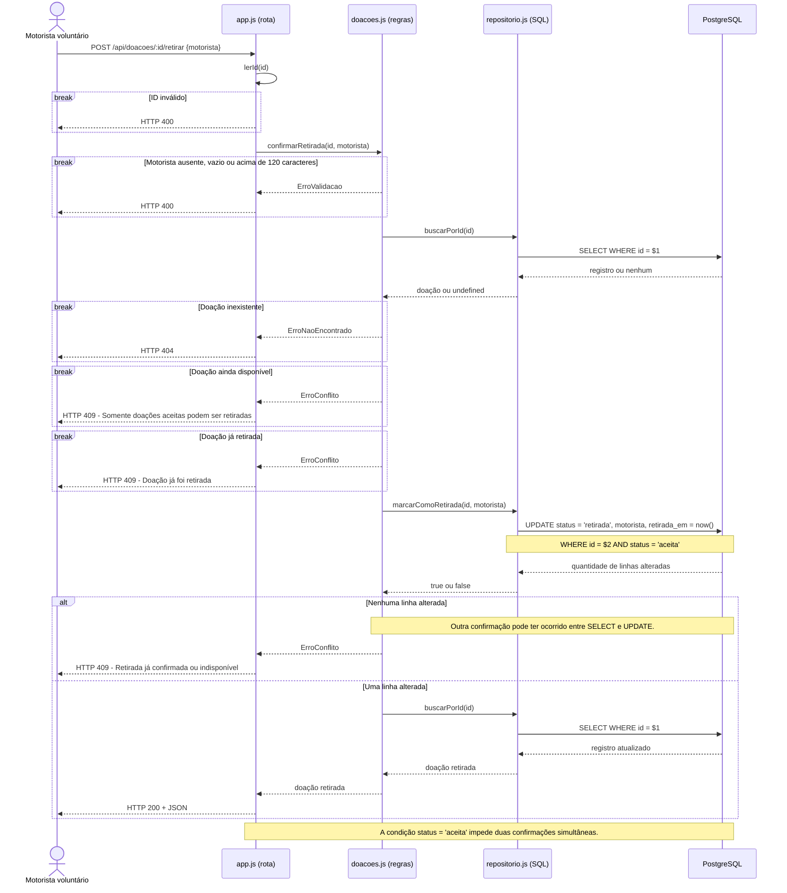

# Diagramas de Sequência — Aceite e confirmação de retirada (versão final)

Pergunta que respondem: **como os componentes do sistema interagem durante o aceite de uma doação e sua posterior retirada, incluindo os caminhos de sucesso e erro?**

O primeiro fluxo representa o aceite de uma doação pela ONG, já existente na `main`. O segundo representa a confirmação de retirada pelo motorista voluntário, desenvolvida na História 8, na branch `feat/confirmar-retirada-doacao`, integrada à `main` pelo PR #10.

## 1. Aceite de doação pela ONG



## 2. Confirmação de retirada pelo motorista voluntário — História 8



## Decisões técnicas representadas

| Aspecto | Aceite da ONG | Confirmação de retirada |
|---|---|---|
| Endpoint | `POST /api/doacoes/:id/aceitar` | `POST /api/doacoes/:id/retirar` |
| Responsável pela operação | ONG | Motorista voluntário |
| Campo obrigatório | `ong` | `motorista` |
| Estado exigido | `disponivel`, com validade vigente | `aceita` |
| Estado resultante | `aceita` | `retirada` |
| Data registrada | `aceita_em` | `retirada_em` |
| Proteção contra concorrência | `UPDATE` condicional por estado e validade | `UPDATE` condicional por estado |
| Confirmação duplicada | HTTP 409 | HTTP 409 |

## Observações

A validação inicial consulta o registro antes da atualização. Entretanto, a proteção definitiva contra operações simultâneas ocorre no PostgreSQL, por meio das condições do `UPDATE`.

Na confirmação de retirada, caso nenhuma linha seja alterada, o serviço retorna conflito HTTP 409. Diferentemente do aceite, essa operação não realiza uma nova consulta para identificar o motivo específico da falha concorrente.

Os dois fluxos são implementados na mesma arquitetura, composta pela rota Express, serviço de regras de negócio, repositório SQL e PostgreSQL.

**Situação de integração:** integrado à `main` pelo PR #10 (`fff59e0`). O fluxo de retirada faz parte do comportamento atual.

## Fontes

- `src/app.js` — `lerId`, rotas de aceite e retirada, middleware de erros
- `src/doacoes.js` — `aceitar`, `confirmarRetirada`
- `src/repositorio.js` — `buscarPorId`, `marcarComoAceita`, `marcarComoRetirada`
- `src/erros.js` — tratamento dos erros de aplicação
- `migrations/002_adiciona_confirmacao_retirada.sql` — branch da História 8
- `docs/analise.md` — regras de negócio e riscos de concorrência
```