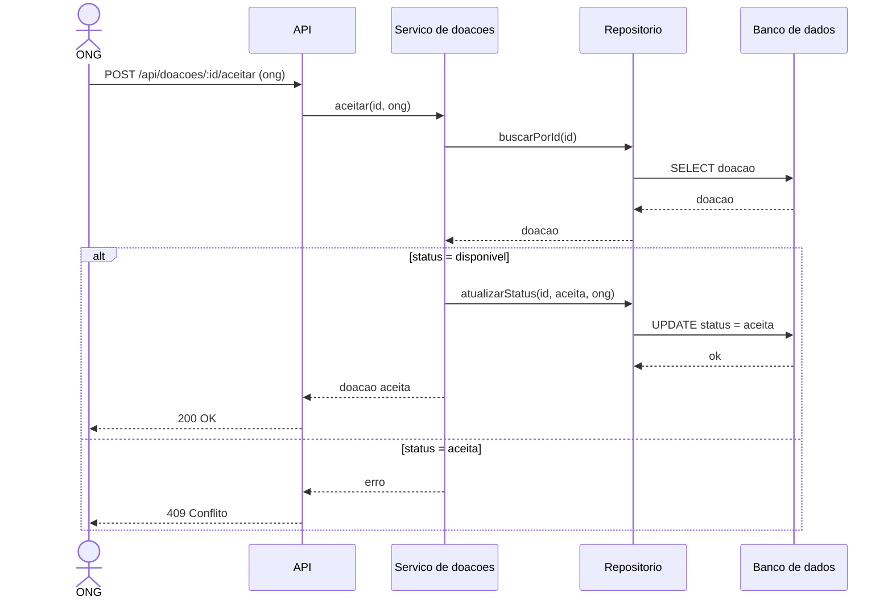

# Versão inicial (IA) — Diagrama de Sequência: ONG aceita uma doação

> **Versão original gerada pela IA, sem nenhuma correção.** Não editar este arquivo.
> Ferramenta: Claude (Anthropic). Entrada fornecida: histórias de usuário, regras de negócio, riscos e
> decisões de `docs/analise.md` e `docs/projeto.md` (texto), **sem o código-fonte**.

