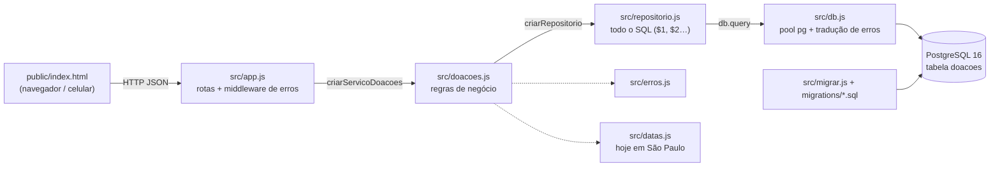
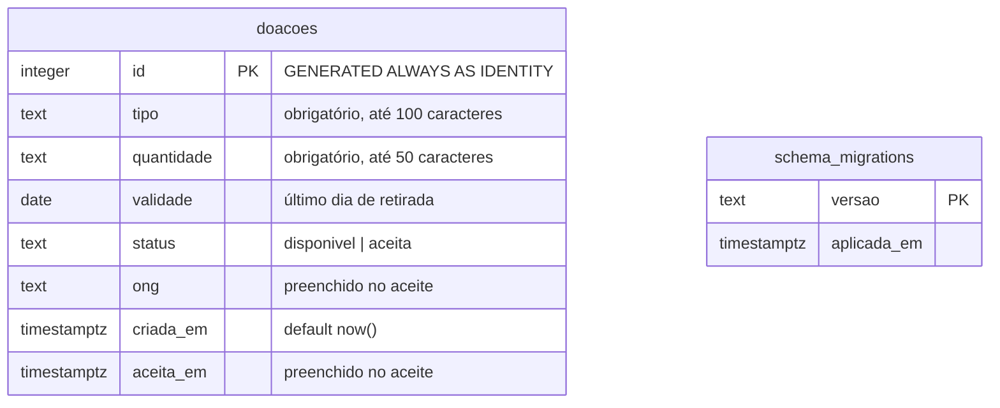

# Documento de Projeto — Prato Cheio

*Atividade Avaliativa 2 (N2) · evolução do walking skeleton da Unidade 1*

Este documento resume o que foi implementado nesta evolução, as decisões tomadas e os requisitos não
funcionais. Tudo aqui aponta para o código e para os testes que comprovam; se algo divergir, vale o código.

## Histórias implementadas

As histórias vêm da tabela de histórias de `docs/analise.md`. Cada critério tem um código que aparece
no nome do teste correspondente.

### História 6 — Esconder doações vencidas (Regra 1)

> Como ONG, quero visualizar doações disponíveis que ainda estejam dentro da janela de retirada,
> para escolher uma opção que possa ser coletada a tempo.

| Critério | Dado / Quando / Então | Teste (`tests/vencidas.test.js`) |
|---|---|---|
| **6a** | **Dado** doações com validade hoje e no futuro, **quando** a ONG consulta a lista, **então** elas aparecem (a que vence antes primeiro). | `[6a] mostra as doações que vencem hoje e as que vencem no futuro` |
| **6b** | **Dado** uma doação cuja validade já passou, **quando** a ONG consulta, **então** ela não aparece. | `[6b] não mostra a doação cuja validade já passou` |
| **6c** | **Dado** uma doação vencida, **quando** uma ONG tenta aceitá-la, **então** recebe 409 "Doação vencida não pode ser aceita" e a doação não muda. | `[6c] recusa com 409…`, `[6c] a doação vencida continua sem ONG…`, `[6c] doação já aceita continua respondendo "já foi aceita"…` |
| **6d** | **Dado** validade anterior a hoje, **quando** o doador publica, **então** recebe 400 e nada é gravado. | `[6d] recusa com 400…`, `[6d] não grava nada…` |

**Onde está:** `validade >= CURRENT_DATE` na listagem e no `UPDATE` atômico do aceite
(`src/repositorio.js:27` e `:47`); motivo do 409 em `aceitar` (`src/doacoes.js:131`); recusa na
publicação (`src/doacoes.js:56`); "hoje" no fuso de São Paulo (`src/datas.js:19`), o mesmo da conexão
(`src/db.js:51`).

### História 5 — Consultar rastreio de uma doação

> Como Vigilância Sanitária, quero que as doações mantenham informações mínimas de rastreabilidade,
> para possibilitar a identificação do alimento doado quando necessário.

| Critério | Dado / Quando / Então | Teste (`tests/rastreio.test.js`) |
|---|---|---|
| **5a** | **Dado** uma doação publicada, **quando** a Vigilância consulta pelo id, **então** recebe tipo, quantidade, validade, status e o instante da publicação. | `[5a] devolve tipo, quantidade, validade, status e instante da publicação` |
| **5b** | **Dado** uma doação aceita, **quando** consulta pelo id, **então** vê também a ONG e o instante do aceite — mesmo fora da lista. | `[5b] uma doação aceita mostra a ONG…`, `[5b] a doação aceita sai da lista, mas continua consultável…` |
| **5c** | **Dado** um id inexistente, **quando** consulta, **então** recebe 404. | `[5c] responde 404 para doação inexistente` |
| **5d** | **Dado** um id inválido (`abc`, `0`, `-1`, `1.5`, acima do INTEGER), **quando** consulta, **então** recebe 400 sem consultar o banco. | `[5d] responde 400 para id inválido…` (5 casos), `[5d] id inválido é recusado sem consultar o banco` |

**Onde está:** rota `GET /api/doacoes/:id` (`src/app.js:82`), validação do id em `lerId`
(`src/app.js:20`), `buscarPorId` com 404 (`src/doacoes.js:95`). Na tela: "Consultar doação (rastreio)".

### Fora do escopo desta evolução

- Histórias 4 e 8 (motorista confirma a retirada) e Regra 3 (ONG aceita e não retira — aguarda a Marta).
- Autenticação: o nome da ONG continua sendo informado, não verificado. Por isso não há cenário de
  "permissão negada" (403) nos testes — não existe identidade para negar.

## Decisões de projeto

| # | Decisão | Alternativas | Requisito/risco da Análise que a motiva | ADR |
|---|---|---|---|---|
| 1 | Stack Node.js + Express | Python/Flask; PostgreSQL desde a U1 | Setup simples, stack da disciplina | [0001](adr/0001-escolha-da-stack.md) |
| 2 | **PostgreSQL 16 em Docker Compose, driver `pg` com SQL à mão, migrations `.sql` versionadas** | manter SQLite; Neon/Supabase; PostgreSQL instalado; ORM (Prisma); Knex | Exigência da U3; concorrência no aceite (Regra 2); datas reais para a Regra 1 | [0002](adr/0002-migracao-sqlite-para-postgresql.md) |
| 3 | **Camadas com injeção de dependência por fábricas e erros tipados** | imports diretos + `vi.mock`; container de DI; status pelo texto da mensagem | Testar falha de banco e entrada inválida; status HTTP confiável | [0003](adr/0003-camadas-com-injecao-de-dependencia-e-erros-tipados.md) |
| 4 | "Hoje" sempre no fuso `America/Sao_Paulo` (app e banco) | fuso do servidor; UTC | Regra 1: entre 21h e meia-noite UTC já é amanhã | — (`src/datas.js`) |
| 5 | Doação que vence hoje ainda aparece | esconder no dia da validade | A validade é o último dia de retirada ("retirar até") | — |

## Tabela de trade-offs (decisão 2 em detalhe)

| Critério | SQLite (como era) | PostgreSQL + Docker (escolhido) |
|---|---|---|
| Setup para quem chega | `npm install` | `npm install` + Docker + `docker compose up -d` |
| Concorrência de escrita | uma escrita por vez | por linha |
| Tipos de data | `TEXT` | `DATE` / `TIMESTAMPTZ` |
| Testes | em memória, mais rápidos | contêiner `db-teste`; arquivos de teste em série |
| Igual em dev, testes e CI | sim | sim (mesma imagem) |

Comparação completa (incluindo Neon e ORM) no [ADR 0002](adr/0002-migracao-sqlite-para-postgresql.md).

## Requisitos não funcionais

Três RNFs escolhidos porque se aplicam ao que existe no sistema. Os testes levam a etiqueta `[RNF1]`,
`[RNF2]` ou `[RNF3]` em `tests/rnf.test.js`; outros testes que também os comprovam estão indicados.

| RNF | Enunciado | Onde aparece no código | Como é verificado | Impacto no projeto |
|---|---|---|---|---|
| **RNF1 — Confiabilidade** | Toda entrada é validada e todo erro responde no mesmo formato `{ "erro": "…" }` com o status certo; banco fora do ar responde 503, não 500. | `src/erros.js:4-39` (classes com status); middleware de erros `src/app.js:111`; `validarDadosDoacao` `src/doacoes.js:31` (inclui data real `AAAA-MM-DD`, `:51`); tradução de falha de conexão `src/db.js:28` | `[RNF1]` em `tests/rnf.test.js`; `Falha de banco` em `tests/postgresql.test.js` (banco inalcançável de verdade → 503); `[0.1b]`, `[5c]`, `[5d]`, `[6d]` | O middleware deixou de decidir o status pelo texto da mensagem; a validação de data foi exigida pela coluna `DATE` |
| **RNF2 — Manutenibilidade / Testabilidade** | O acesso a dados fica isolado em camadas e cada camada recebe suas dependências, para poder ser trocada nos testes. | `criarApp({ db })` `src/app.js:41-42`; `criarServicoDoacoes(repositorio)` `src/doacoes.js:65`; `criarRepositorio(db)` `src/repositorio.js:10`; driver só em `src/db.js:38`; schema em `migrations/` + `src/migrar.js:17` | `[RNF2]` em `tests/rnf.test.js` (regras testadas com repositório falso, sem banco); `[5d] … sem consultar o banco` (db espião); os 16 testes da U1 passaram sem alteração após trocar o banco | A migração SQLite → PostgreSQL ficou contida em `db.js` e `repositorio.js` (ADR 0002 e 0003) |
| **RNF3 — Segurança** | Nenhum valor do usuário é concatenado em SQL; erros não expõem detalhes internos; entradas têm limite de tamanho; o servidor não anuncia sua tecnologia. | Consultas com `$1, $2…` em `src/repositorio.js` (ex.: `:15`, `:35`, `:46`); 500 genérico `src/app.js:129`; limite de 100 kb `src/app.js:56`; `TAMANHO_MAXIMO` `src/doacoes.js:6`; `x-powered-by` desligado `src/app.js:46`; `nosniff` `src/app.js:51`; credenciais só em variável de ambiente (`.env` fora do Git) | `[RNF3]` em `tests/rnf.test.js`: SQL malicioso gravado como texto e tabela intacta, 500 sem "relation"/"doacoes", 413, tamanho máximo, cabeçalhos | Sem autenticação ainda — o maior risco de segurança restante (ver Riscos em `docs/analise.md`) |

## Diagramas

### Da atividade anterior

- Mapa de stakeholders: em [`docs/analise.md` → Mapa de stakeholders](analise.md#mapa-de-stakeholders).
- **PREENCHER:** links dos diagramas da atividade anterior (contexto, dados/componentes). Eles não
  estavam no repositório quando este documento foi escrito.

### Estados e sequência (atividade "Projeto" com apoio de IA)

Diagrama de estados da doação e de sequência do aceite, com a versão inicial da IA, os problemas
encontrados e as versões finais: [`docs/diagramas/`](diagramas/README.md).

### Componentes (estado atual do código)

### Dados

## ADRs

Ver `docs/adr/`: [0001 — stack](adr/0001-escolha-da-stack.md) ·
[0002 — SQLite → PostgreSQL](adr/0002-migracao-sqlite-para-postgresql.md) ·
[0003 — camadas com injeção de dependência e erros tipados](adr/0003-camadas-com-injecao-de-dependencia-e-erros-tipados.md).

## Critérios de validação do projeto

- `npm test` verde, localmente e no CI (PostgreSQL real como service container).
- Todo critério de aceite (0.x, 5x, 6x) e todo RNF tem pelo menos um teste com o código no nome.
- Os testes da Unidade 1 continuam passando depois da troca de banco (evidência da refatoração).
- Cobertura gerada por `npm run test:cobertura`.
- Cada mudança entra por Pull Request revisado por outro integrante.

## Uso de IA

O código, os testes e a primeira versão desta documentação foram gerados com apoio do Claude Code a
partir dos critérios de aceite e decisões definidos pelo grupo, e revisados antes de cada commit.
**PREENCHER:** o que foi alterado ou recusado do que a IA sugeriu.
